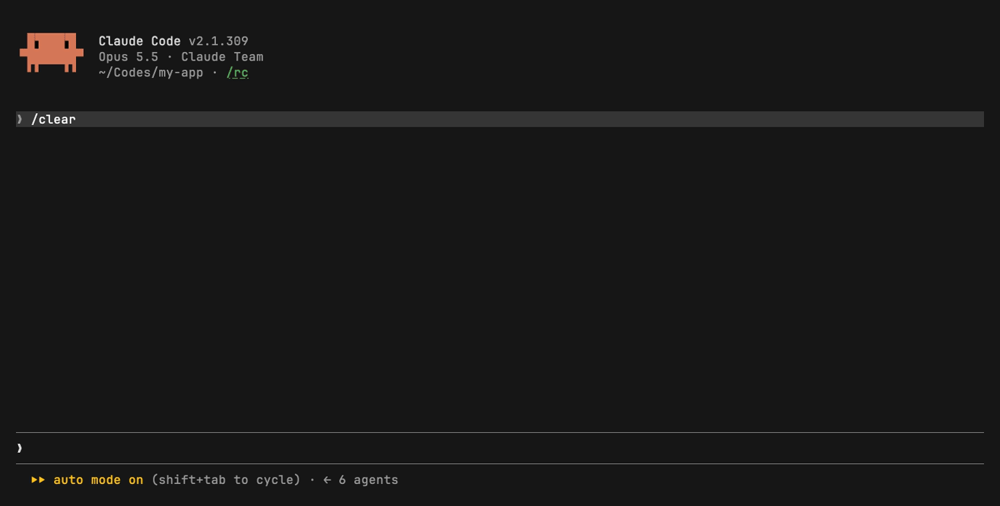

# todo — a persistent TODO pane for Claude Code

Keep a TODO list next to your Claude Code chat. Add, finish, edit and remove items in a pane, with `/todo`, or by asking Claude. The list lives in plain Markdown files, so it survives every session and stays readable in any editor.



## Features

- **A pane beside the chat** with two tabs: a global list and a list for the current project.
- **A one-line summary above the prompt**: open items, the next one, and overdue items.
- **`/todo` runs instantly.** It changes the list without a model turn.
- **Claude can manage the list when you ask.** For example: "add the rollback script review to my TODO".
- **Priority, due date and notes** for each item. The list sorts by priority, then by due date.
- **Plain Markdown storage**: `~/.claude/todo.md` (global) and `TODO.md` at the project's git root.
- **Korean and English UI**, chosen automatically.

## Install

Type these at the Claude Code prompt:

```
/plugin install todo --marketplace wlsdnen/claude-code-todo
```

Press `y` to add the marketplace, then pick a scope.

**Requirements:** the Claude Code CLI 2.1.287 or later, the Desktop app's Code tab, or the VS Code extension 2.1.299 or later. Panes are not drawn in `claude -p`, Agent SDK or cloud sessions.

## Usage

### In the pane

| Key | Action |
|---|---|
| select a row | open it and show its note |
| `d` | mark done / not done |
| `e` | edit the text and the note |
| `x` | remove |
| bottom field | add a new item |

Use `ctrl+x tab` or a click to move focus into the pane.

### `/todo` command

```
/todo                              open or close the pane
/todo add Ship docs !high fri      add to the global list
/todo -p add Fix flaky test +2d    add to the project list
/todo done 2                       mark item 2 done
/todo edit 2 Ship docs v2 !low     change item 2
/todo rm 3                         remove item 3
```

Item numbers follow the order on screen.

### Priority and due dates

Put them at the end of the text.

- Priority: `!high`, `!mid` (the default), `!low`
- Due date: `today`, `tomorrow`, `mon`…`sun`, `next week`, `+3d`, `+2w`, `10/25`, `2026-10-25`. Korean words also work: `오늘`, `내일`, `모레`, `금요일`.

### Ask Claude

The plugin gives Claude one tool, `todo`. Its description tells Claude to use it only when you ask about your TODO list, not to add items on its own. This tool is separate from Claude's built-in session task list.

## File format

```markdown
- [ ] Reply to PR review !high due:2026-10-25
  2 of 3 comments need code changes
- [ ] Deploy checklist
- [x] Write meeting notes
```

An indented line under an item is its note. Lines that are not items, such as headings, stay as they are. You can edit the file by hand, and the pane picks up changes Claude makes with its Write or Edit tools.

## Development

```sh
git clone https://github.com/wlsdnen/claude-code-todo
claude --plugin-dir ./claude-code-todo   # run Claude Code with the plugin loaded
claude plugin test ./claude-code-todo     # run the tests
claude plugin validate ./claude-code-todo
```

## License

[MIT](LICENSE)
